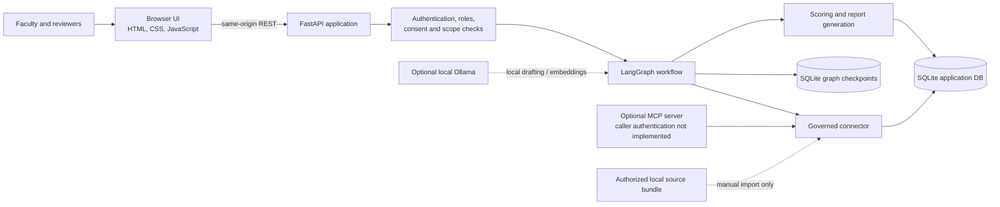
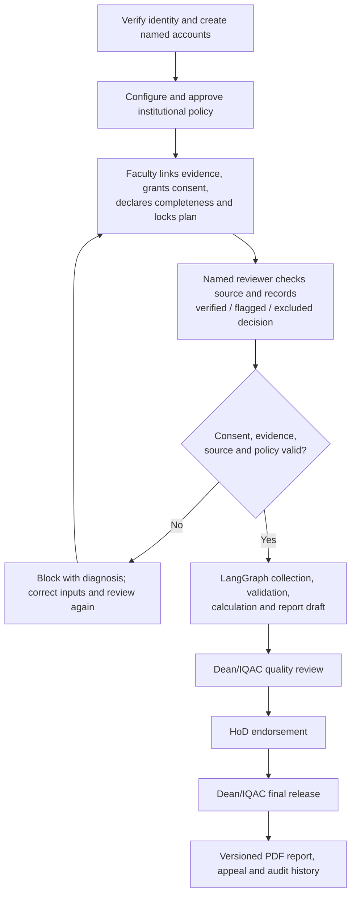

# KLE Faculty Appraisal

[](https://www.python.org/)
[](https://fastapi.tiangolo.com/)
[](https://docs.langchain.com/oss/python/langgraph/overview)
[](./LICENSE)

> A local-first faculty appraisal workflow prototype with evidence traceability and required human review. It is not an institutional production deployment.

## Project Overview

KLE Faculty Appraisal is a locally run web application for organizing departmental appraisal plans, activity claims, supporting evidence, review decisions, policy-based calculations, and released reports. The Python backend serves a static browser interface and stores application data in SQLite. LangGraph coordinates the appraisal workflow; people, not agents, verify evidence and approve policy and reports.

The public repository deliberately does not include the supplied source records, extracted seed data, runtime databases, or demo credentials. The application includes a synthetic demo mode for trying the workflow without those files.

## Course and Team Details

> **Submission details pending.** Names, USNs, division, and course identifiers have not been supplied. Replace these placeholders with the verified course details; do not infer them from application data.

## Course Details and Team Information

| Course Detail | Value |
|---|---|
| Course / Subject | Faculty Appraisal Management System |
| Division | B |

### Team Members

| Sl. No. | Team Member Name | USN | Division |
|---|---|---|---|
| 1 | Trisha Shedbal | 01FE24BCI405 | B |
| 2 | Navya Ainapur | 01FE23BCI110 | B |
| 3 | Saivishwaksena | 01FE23BCI020 | B |
| 4 | Triveni Patil | 01FE23BCI030 | B |
## Assignment Overview

> Assignment names, descriptions, and original files have not been provided. The linked numbered pages are placeholders, not assignment submissions.

| Assignment | Description | Material |
|---|---|---|
| Assignment 01 | Pending source material | [Placeholder](./Course%20Project/Assignments/Assignment-01/README.md) |
| Assignment 02 | Pending source material | [Placeholder](./Course%20Project/Assignments/Assignment-02/README.md) |
| Assignment 03 | Pending source material | [Placeholder](./Course%20Project/Assignments/Assignment-03/README.md) |
| Assignment 04 | Pending source material | [Placeholder](./Course%20Project/Assignments/Assignment-04/README.md) |
| Assignment 05 | Pending source material | [Placeholder](./Course%20Project/Assignments/Assignment-05/README.md) |
| Assignment 06 | Pending source material | [Placeholder](./Course%20Project/Assignments/Assignment-06/README.md) |
| Assignment 07 | Pending source material | [Placeholder](./Course%20Project/Assignments/Assignment-07/README.md) |
| Assignment 08 | Pending source material | [Placeholder](./Course%20Project/Assignments/Assignment-08/README.md) |
| Assignment 09 | Pending source material | [Placeholder](./Course%20Project/Assignments/Assignment-09/README.md) |
| Assignment 10 | Pending source material | [Placeholder](./Course%20Project/Assignments/Assignment-10/README.md) |
| Assignment 11 | Pending source material | [Placeholder](./Course%20Project/Assignments/Assignment-11/README.md) |
| Assignment 12 | Pending source material | [Placeholder](./Course%20Project/Assignments/Assignment-12/README.md) |

## Detailed Project Explanation

The application models an appraisal cycle as a sequence of accountable actions. Faculty link claims to source evidence and consent to its use. Reviewers inspect claims and record evidence decisions. A configured institutional policy is used for deterministic scoring. LangGraph coordinates collection and validation and pauses for human approval; it does not grant consent, verify evidence, or approve a report.

The system has a static browser interface, a FastAPI application, a governed connector, a SQLite application store, separate LangGraph checkpoints, and a report generator. Real-source import is an optional local workflow that requires institution-authorized documents; these documents and derived data are excluded from this repository. A separate synthetic demo is provided for trying the application without those records.

The original course problem statement and final course report are not included yet. Their placeholders and the source-code location are indexed in [`Course Project/`](./Course%20Project/README.md).

## Chapter 8 – Lab Assignments

The revised course structure contains 12 labs, including the merged Tool-Using Agent/MCP-Style Connector lab and the merged Evidence Grounding/Ops Resilience lab:

- [Chapter 8 – 12 Lab Assignment Structure](./docs/CHAPTER_8_12_LAB_ASSIGNMENTS.md)

## Problem Statement

An appraisal process needs to connect claims to their source documents, apply an approved rubric consistently, respect faculty consent and access boundaries, and preserve who reviewed each decision. A workflow that treats imported records as verified or allows automated approval would not meet those requirements.

## Objectives

- Keep activity claims traceable to a source file and locator.
- Require source consent and named evidence decisions before appraisal calculation.
- Apply an explicitly configured institutional policy rather than inventing scoring values.
- Make review stages, report versions, appeals, and audit history visible.
- Support a self-contained synthetic demonstration without private institutional records.

## Key Features

- Local, password-authenticated application with role and faculty-scope checks, CSRF protection, session expiry, and login throttling.
- Faculty activity intake, evidence uploads, source consent, and named reviewer decisions.
- Reproducible XLSX/PDF import for the separately supplied source bundle.
- LangGraph-based specialist collection, validation, bounded repair, and checkpointed human interrupts.
- Decimal-based policy calculation using an approved policy version and recorded citations.
- Ordered quality review, HoD endorsement, and final release; versioned PDF reports, appeals, and rollback.
- SQLite persistence and audit events linked by hashes.
- Synthetic-only demo mode and optional localhost Ollama drafting/retrieval.
- An optional MCP server. Its caller identity is not authenticated by this distribution; see [Security and Privacy Considerations](#security-and-privacy-considerations).

## System Architecture

The web application uses a same-origin FastAPI API. The optional MCP process is separate from the browser login/session boundary.



### Technology Stack

| Area | Technology |
|---|---|
| Backend/API | Python 3.12 target, FastAPI, Uvicorn, Pydantic |
| Workflow | LangGraph with SQLite checkpoint persistence |
| Storage | SQLite application repository and graph checkpoints |
| Import/reporting | `openpyxl`, `pypdf`, ReportLab |
| Frontend | Static HTML, CSS, and JavaScript; no Node build step |
| Optional local model | Ollama on localhost |
| Tests | pytest, FastAPI `TestClient` |

## Project Directory Structure

```text
.
├── .github/                 # Issue/PR templates and CI
├── .vscode/                 # Shared launch, task, and editor settings
├── app/                     # API, workflow, security, persistence, reports
├── data/
│   ├── fonts/               # Bundled fonts and attribution
│   ├── source/              # Private supplied inputs; excluded from Git
│   └── seed.json            # Locally extracted private data; excluded from Git
├── docs/                    # Architecture, operations, policy, validation
├── labs/                    # Notebook and benchmark/demo material
├── tests/                   # Automated tests
├── web/                     # Static browser application and assets
├── manage.py                # Setup, run, demo, test, and maintenance commands
├── requirements.txt
├── start_local.sh
└── start_windows.bat
```

Runtime databases, uploaded files, generated reports, private source files, and local configuration are intentionally not part of a public checkout.

## Application Workflow

1. An administrator verifies identities and creates named accounts.
2. Dean/IQAC configures and approves the institution's real scoring policy.
3. Faculty links activities and evidence, grants source-specific consent, declares cycle completeness, and locks an appraisal plan.
4. Reviewers inspect the evidence and record verified, flagged, or excluded decisions.
5. LangGraph collects consented records, checks evidence and policy, calculates scores, and prepares a report. Missing or stale prerequisites block the run.
6. Humans complete quality review, HoD endorsement, and final Dean/IQAC release in order.
7. An approved report can be exported; subsequent versions, appeals, and rollback are retained.



### Evidence Verification and Human Approval

Faculty link claims to sources and grant consent; reviewers inspect the source, locator, and claim before recording a named evidence decision. Once the faculty member declares completeness and locks the plan, LangGraph processes only scoped, consented inputs and returns a draft with checks and citations, or a blocked result. Dean/IQAC quality review, HoD endorsement, and final Dean/IQAC release remain separate human decisions before the approved version is made available.

## Approach

The implementation uses a local-first, role-aware workflow rather than treating imported data or model output as authoritative. Typed application inputs and a governed connector supply scoped records to the workflow. Consent, source integrity, evidence decisions, and an approved policy are checked before scoring. Human review interrupts gate report quality review, HoD endorsement, and final release. SQLite stores application state; LangGraph checkpoints support workflow recovery.

The supported policy and import boundaries are documented in [policy configuration](./docs/POLICY_CONFIGURATION.md), [architecture](./docs/ARCHITECTURE.md), and [data provenance](./docs/DATA_PROVENANCE.md).

## Implementation

The application is implemented in the existing [`app/`](./app/) Python package and [`web/`](./web/) static frontend. [`manage.py`](./manage.py) provides setup, run, synthetic demo, test, importer-check, MCP-check, audit-check, and backup commands. Project dependencies are pinned in [`requirements.txt`](./requirements.txt). No application source has been moved into the submission scaffold; see [`Course Project/Source Code/`](./Course%20Project/Source%20Code/README.md) for the canonical source location and copy instructions.

## Results

The current local validation run completed **36 tests successfully** on the configured Python 3.14 environment. Frontend JavaScript syntax checking, Python compilation, and MCP tool-discovery smoke checking also passed. This is software validation, not a course evaluation result, institutional appraisal result, or production-readiness certification. Python 3.12 CI, browser automation, Ollama integration, and real-institution acceptance remain unverified; see the [validation record](./docs/VALIDATION.md).

## Installation and Setup

Use Python 3.12, the version targeted by the project documentation and CI. Install dependencies from the project root.

**Windows PowerShell**

```powershell
py -3.12 -m venv .venv
.\.venv\Scripts\python.exe -m pip install -r requirements.txt
```

**Linux / macOS**

```bash
python3.12 -m venv .venv
.venv/bin/python -m pip install -r requirements.txt
```

No separate database server, Node.js, or cloud model key is required.

## Running the Application

### Synthetic demo

The demo is the recommended first run and does not need the private source bundle:

```powershell
.\.venv\Scripts\python.exe manage.py demo
```

```bash
.venv/bin/python manage.py demo
```

Before starting the demo, set `KLE_DEMO_PASSWORD` in the local process environment to a private password of at least 12 characters. The application does not load `.env` automatically and does not write demo passwords to disk. Open `http://127.0.0.1:8001` after the server starts. Follow [the demo walkthrough](./docs/DEMO_WALKTHROUGH.md) or [the reviewer workflow](./DEMO_WORKFLOW.md).

### Local operation with authorized source data

Real-data setup requires the institution-authorized original source files, which are not distributed here. Place those files locally under `data/source/`, regenerate the ignored seed, then initialize the local database:

```powershell
.\.venv\Scripts\python.exe app\importer.py
.\.venv\Scripts\python.exe manage.py setup
.\.venv\Scripts\python.exe manage.py run
```

```bash
.venv/bin/python app/importer.py
.venv/bin/python manage.py setup
.venv/bin/python manage.py run
```

The importer writes `data/seed.json`; the setup command reads it and asks for an administrator password. Do not copy real source records, seed files, databases, uploads, or reports into a public checkout. Read [data handling notes](./docs/DATA_PROVENANCE.md) and [operations guidance](./docs/OPERATIONS.md) before using institutional information.

The normal server binds to `127.0.0.1` on port 8000. `manage.py run --port 8010` selects another local port. The supplied Windows and POSIX launcher scripts are also available after environment setup.

## Demo Mode Instructions

Demo mode uses an isolated `runtime-demo/` database and synthetic people, evidence, and training policy. It does not initialize or modify `runtime/app.db`. Configure `KLE_DEMO_PASSWORD` in the local process environment before running `manage.py demo` or `manage.py demo-provision`; the password is not stored in documentation or a credentials file. Complete the documented consent, evidence review, and three approval stages in the UI.

## Optional Ollama Integration

Ollama is optional and is called only through `127.0.0.1:11434`. Without it, report text uses deterministic assembly and retrieval uses the local implementation.

```powershell
ollama pull llama3.2:3b
$env:OLLAMA_MODEL = "llama3.2:3b"
.\.venv\Scripts\python.exe manage.py run
```

For optional semantic embeddings, pull a compatible embedding model and set `OLLAMA_EMBED_MODEL` in the same shell:

```powershell
ollama pull nomic-embed-text
$env:OLLAMA_EMBED_MODEL = "nomic-embed-text"
```

```bash
ollama pull llama3.2:3b
OLLAMA_MODEL=llama3.2:3b .venv/bin/python manage.py run
```

Model output does not approve evidence, choose policy values, calculate authoritative scores, or release reports. Treat model text as untrusted and retain human review.

## Testing and Validation

```powershell
.\.venv\Scripts\python.exe -m pytest -q
.\.venv\Scripts\python.exe manage.py mcp-check
node --check web\assets\app.js
```

The source-reconciliation test requires the private XLSX/PDF bundle and is skipped when that bundle is absent. Other tests use synthetic fixtures. `manage.py import-check` is for authorized local source files, not a clean public clone. See [validation notes](./docs/VALIDATION.md) for what has and has not been exercised.

## Screenshots

Screenshots are intentionally not included yet. Add only screenshots captured from the synthetic demo and reviewed to ensure that no real names, records, credentials, or browser data are visible.

| View | Placeholder |
|---|---|
| Login and dashboard | `docs/screenshots/dashboard.png` |
| Evidence review | `docs/screenshots/evidence-review.png` |
| Approval workflow | `docs/screenshots/approval-workflow.png` |
| Released synthetic report | `docs/screenshots/synthetic-report.png` |

## Security and Privacy Considerations

- The supplied source directory contains institutional material, including faculty-identifying roster imagery and appraisal-related research/teaching records. The extracted seed reproduces those records. These files and their manifests are excluded from Git; runtime databases and uploaded evidence are excluded too.
- A repository ignore rule does not remove files already tracked elsewhere or from Git history. Before publication, inspect `git status`, `git check-ignore`, and the final staged diff. Never force-add ignored source, seed, runtime, upload, or report files.
- The application is a local pilot, not a hardened public service. The default HTTP server binds to loopback; network hosting requires an institutional security review, TLS, secure cookies (`COOKIE_SECURE=1`), access-controlled storage, backup protection, and deployment testing.
- SQLite files and local uploads are not encrypted by the application. Protect the workstation and backups using institution-approved controls.
- The optional MCP server has no authenticated caller identity in this implementation. Its SSE listener rejects non-loopback bind addresses, but its tools still accept caller-supplied role/scope fields. Use only locally with synthetic data; do not point it at real appraisal data or expose it to untrusted clients until authenticated identity and authorization are implemented.
- No institution-approved scoring rubric, real consent, identity mapping, evidence decision, or approval is bundled. The demo rubric and records are synthetic only.
- Hash-linked audit events detect some tampering but are not protection against an administrator who can rewrite the database and recompute the chain.

Review [SECURITY.md](./SECURITY.md) and [operations guidance](./docs/OPERATIONS.md). Report suspected exposure privately to the repository maintainer; no security contact address has been supplied yet.

## Configuration and Environment Variables

The application reads these variables from its process environment; it does not automatically load a `.env` file.

| Variable | Purpose | Default / notes |
|---|---|---|
| `APP_DB` | SQLite application database path | `runtime/app.db`; demo sets its own database path |
| `KLE_DEMO_PASSWORD` | Local synthetic demo account password | Required for demo setup/provisioning; minimum 12 characters |
| `COOKIE_SECURE` | Set secure-cookie attribute | Only `1` enables it; use for HTTPS deployments |
| `OLLAMA_MODEL` | Optional local narrative generation model | Unset means deterministic report assembly |
| `OLLAMA_EMBED_MODEL` | Optional local embeddings model | Unset means local lexical retrieval |

The [`.env.example`](./.env.example) contains placeholders only and is not loaded automatically. Never put actual passwords, tokens, or real personal data in source control or an example configuration file.

## Limitations and Future Enhancements

- The package targets a single departmental local pilot; reviewer roles do not provide a complete multi-department authorization model.
- Campus SSO, live SIS/HR integrations, external publication verification, and email delivery are not implemented.
- An institution must supply and approve its own rubric, rating bands, identity mappings, source consents, and evidence decisions.
- Import support is specific to the separately supplied XLSX/PDF formats; arbitrary uploaded documents are not automatically parsed.
- The MCP process needs authenticated caller identity and authorization before use with non-synthetic records.
- Browser automation, hosted deployment, operational backup/restore drills, and production concurrency testing remain future validation work.

See [the implementation gap report](./docs/IMPLEMENTATION_GAP_REPORT.md) for additional boundaries.

## Contribution Guidelines

Read [CONTRIBUTING.md](./CONTRIBUTING.md) before proposing changes. Contributions must use synthetic fixtures, preserve source attribution, and avoid committing private records or credentials.

## License

No project license has been selected. The repository is therefore unlicensed; do not assume permission to reuse, modify, or redistribute it. See [LICENSE](./LICENSE) for the status and the decision needed from the project owner. Third-party asset notices remain in [docs/](./docs/).

## Author / Project Credits

Author and maintainer names were not supplied, so none are asserted here. The bundled DejaVu fonts have a Bitstream Vera/DejaVu redistribution notice in [`docs/FONT_LICENSE.txt`](./docs/FONT_LICENSE.txt). The web fonts Nimbus Sans and P052 are from the URW Base 35 family; [`docs/PDF_FONT_LICENSE.txt`](./docs/PDF_FONT_LICENSE.txt) records their AGPL-3 font-exception terms. The institutional logo has no redistribution permission documented here, so its local copy is excluded from Git. The logo and web-font files remain on the working machine but are not part of public distribution; the interface uses system font fallbacks and PDF reports omit the logo if it is unavailable. See [the asset licensing notes](./docs/ASSET_LICENSES.md). No contributors, institutional endorsement, or deployment are implied.

## Existing Documentation

- [Quick start](./START_HERE.md)
- [Demo reviewer workflow](./DEMO_WORKFLOW.md)
- [Architecture](./docs/ARCHITECTURE.md)
- [Data provenance and handling](./docs/DATA_PROVENANCE.md)
- [Demo walkthrough](./docs/DEMO_WALKTHROUGH.md)
- [Operations](./docs/OPERATIONS.md)
- [Policy configuration](./docs/POLICY_CONFIGURATION.md)
- [Validation record](./docs/VALIDATION.md)
- [Worklet traceability](./docs/WORKLET_TRACEABILITY.md)
- [Implementation gaps](./docs/IMPLEMENTATION_GAP_REPORT.md)
- [Course submission scaffold](./Course%20Project/README.md)
